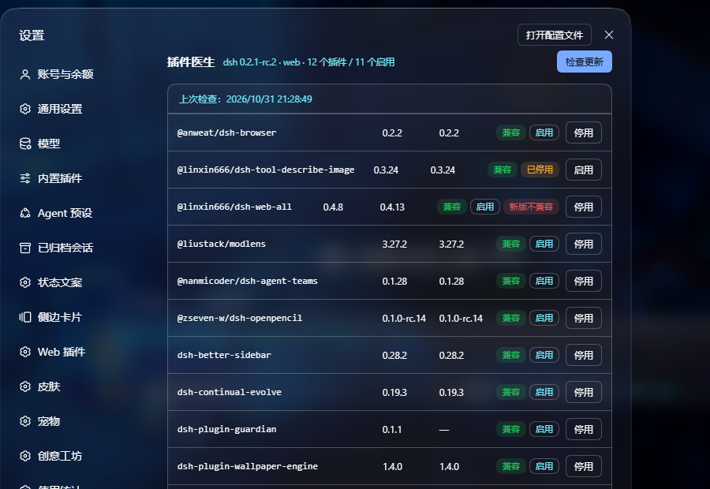

# dsh-plugin-guardian

A plugin doctor for the [DeepSeek Harness](https://github.com/deepseek-ai/deepseek-harness) (`dsh`).

It answers four questions every DSH user eventually hits:

1. **Which of my plugins still work with this dsh version?** — it grades every
   installed plugin with exactly the rule the runtime uses (`engines.dsh` when
   declared, otherwise every `@deepseek-ai/dsh*` peer range).
2. **Which plugins have a newer version I can actually install?** — it reads the
   registry, grades the *latest* release too, and separates "update available"
   from "newer release already requires a newer dsh".
3. **How do I get back to a working state when the web UI no longer boots?** — a
   dependency-free CLI that never loads the harness: it can suspend the offending
   bundles, resume them later, and install/upgrade plugins from a terminal.
4. **What plugin does X?** — describe the feature in plain language (Chinese or
   English) and it searches the community registry, npm and GitHub, ranking hits
   by relevance and marking whether each one is compatible with your dsh.



## Install

```bash
# from npm (once published)
dsh plugin --profile web add dsh-plugin-guardian

# from a git checkout
dsh plugin --profile web add github:<user>/dsh-plugin-guardian

# from a local folder (development)
dsh plugin --profile web add link:/absolute/path/to/dsh-plugin-guardian
```

Then make sure it is registered as a bundle — the packaging step normally does
this for you, but a `link:` install does not:

```jsonc
// ~/.dsh/profiles/web/package.json
"dsh": { "profile": { "bundles": [ "...", "dsh-plugin-guardian" ] } }
```

Restart the profile (`dsh --profile web`, or restart the desktop shell).

## Where you meet it

| Surface | What you get |
|---|---|
| **Settings → 插件医生** | Status per plugin, update check, upgrade / suspend / resume, requirement search with one-click install |
| `/guardian` command | Text report; `/guardian find 自动写周报`, `/guardian install <pkg>`, `/guardian suspend <pkg>` |
| `dsh-guardian` CLI | The same engine without booting the harness — works when the UI is broken |
| `GET /guardian?t=<token>` | Standalone panel page (token is printed by `/guardian`) |

The settings entry needs the `settings.section` slot; DSH's own settings dialog
and the popular `@linxin666/dsh-client-ui-web-ui-settings` both provide it. If
your UI has no such slot, use the command, the CLI or the panel page — they do
not depend on it.

## Compatibility rule

The runtime refuses a plugin when its declared requirements are unmet:

- an own `engines.dsh` range decides **alone** (peer ranges are then ignored), or
- otherwise every `@deepseek-ai/dsh` / `@deepseek-ai/dsh-*` peer range must be
  satisfied by the running dsh version (prereleases included).

Guardian implements the same evaluation in `lib/doctor.js` and reuses the
runtime's own `semver` package, so a "compatible" badge means the boot will not
disable that row.

## Auto-suspend (opt-in)

When a bundle is incompatible, guardian can remove it from
`dsh.profile.bundles` on the next start — the plugin files stay installed, so
`resume` is one click. This is **off by default** for new profiles:

```bash
dsh-guardian autosuspend on      # opt in
dsh-guardian autosuspend off     # back to "only report"
```

Turn it on from the settings section too. Nothing else is ever written without
an explicit action: update checks are read-only, and upgrades only happen when
you click "升级".

## CLI

```bash
dsh-guardian doctor          # offline health report
dsh-guardian check           # registry check (network)
dsh-guardian fix             # suspend incompatible / missing bundles
dsh-guardian suspend <pkg>   # disable one plugin
dsh-guardian resume <pkg>    # enable it again
dsh-guardian upgrade <pkg>   # install the newest compatible release
dsh-guardian upgrade-all
dsh-guardian install <spec>  # npm name, github:user/repo, or a version spec
dsh-guardian find <text>     # requirement search
dsh-guardian autosuspend on|off
dsh-guardian where           # paths + detected dsh version
```

Options: `--profile <name>` (default `web`), `--home <DSH_HOME>`,
`--runtime <path/to/dsh/lib/bin.js>`, `--json`.

The CLI needs no running harness. It locates `$DSH_HOME` (or `~/.dsh`), the
profile, and the newest installed `dsh` on its own; `--runtime` and the
`BIGFISH_DSH_BIN` / `DSH_BIN` environment variables override the lookup.

## State and files

| Path | Content |
|---|---|
| `<DSH_HOME>/guardian/state.json` | panel token, last check results, suspended/pending lists, operation history |
| `<DSH_HOME>/profiles/<name>/package.json` | the only file `suspend` / `resume` / `install` rewrite |
| `GET /guardian?t=<token>` | standalone panel (token rotates only if the state file is rebuilt) |

The HTTP API (`/guardian/api/*`) accepts either the panel token or a
same-origin request (`Sec-Fetch-Site: same-origin`), which is how the settings
section reads data without handling secrets.

## Optional: desktop shell integration

If you run guardian inside an Electron shell (Bigfish), the shell can add three
things guardian cannot do itself, because they must work *before* the harness
boots: apply the pending-suspend list, run the CLI from the boot-failure page,
and open the panel window. See [`integrations/bigfish`](integrations/bigfish/README.md).

## Limitations

- The UI strings are Chinese; the CLI and README are bilingual-ish.
- Requirement search needs network. `awesome-dsh-plugin.com` is often slow from
  mainland China, so npm search usually carries the result list.
- GitHub results are filtered to repositories that look like DSH plugins; the
  GitHub API may be unreachable depending on your network.
- Guardian never upgrades anything automatically — "automatic" stops at
  reporting and (opt-in) suspending.

## Development

```bash
npm test        # 30 logic tests against temporary DSH_HOME fixtures
```

No build step: `lib/index.js` is plain ESM, `lib/client.js` is the browser
module format the harness loader expects, and `lib/panel.html` is static.

## 中文速览

给 DeepSeek Harness 做的「插件医生」：

- **体检**：按运行时同样的规则判断每个插件还能不能用
- **更新**：查最新版，并区分「可以升」和「新版已经要求更高 dsh」
- **修复**：harness 起不来时，用离线 CLI 停用出问题的插件（文件保留，可随时恢复）
- **找插件**：用一句话描述需求，去社区目录 / npm / GitHub 搜并标注兼容性

入口：设置 → 插件医生、`/guardian` 命令、`dsh-guardian` 命令行、`/guardian` 面板页。
自动停用默认关闭（`dsh-guardian autosuspend on` 开启），其余写操作都需要你亲手点。

## License

MIT
